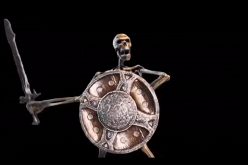

# 💀 Skeleton-Meme / Doomscroll Stopper

<p align="center">
  
  
  
  
  
  
</p>

<p align="center">
  
</p>

---

## Sobre el Proyecto

**Skeleton-Meme** es una herramienta de productividad y visión artificial diseñada para frenar el *doomscrolling* (perder el tiempo mirando el móvil) mientras trabajas o estudias en tu ordenador.

Utilizando la cámara web en tiempo real junto con **OpenCV** y **MediaPipe Face Mesh**, el programa analiza el ángulo vertical de la mirada mediante las coordenadas del iris. Si detecta que bajas la cabeza o la vista hacia el móvil durante más de 2 segundos, ¡el mítico meme del **Skyrim Skeleton** aparecerá en pantalla para llamarte la atención!

> 🎓 **Nota del Estudiante:**
> Proyecto desarrollado por **Ignacio Breñas Muñoz** (estudiante de 1º de DAW en STUCOM Pelai) como práctica personal para investigar **Python**, visión por computadora en tiempo real y arquitecturas de eventos multimedia.

---

## ¿Cómo Funciona? (Arquitectura Técnica)

1. **Captura de Vídeo:** Lee los fotogramas de la webcam con OpenCV.
2. **Rastreo Facial con MediaPipe Face Mesh:** Extrae los puntos de referencia (landmarks) de los ojos, párpados y la posición exacta del iris.
3. **Cálculo de Mirada hacia Abajo:** Compara la posición del iris respecto a los límites verticales de los párpados. Si la relación supera el umbral configurado (`LOOK_DOWN_THRESHOLD`), se activa el contador de distracción.
4. **Disparador del Meme:** Si la mirada se mantiene hacia abajo durante más de 2 segundos:
   - Maximiza o reproduce el vídeo meme del esqueleto a pantalla completa.
   - Pone el volumen de Windows al 100% mediante `pycaw`.
   - Se silencia automáticamente una vez que el usuario vuelve a mirar hacia arriba.

---

## Requisitos e Instalación

### 1. Clonar el repositorio
```bash
git clone https://github.com/Ignaciobrenas/Skeleton-Meme.git
cd Skeleton-Meme
```

### 2. Crear entorno virtual (opcional pero recomendado)
```bash
python -m venv venv
venv\Scripts\activate
```

### 3. Instalar dependencias
```bash
pip install -r requirements.txt
```

### 4. Ejecutar
```bash
python main.py
```

Para salir de la aplicación, pulsa la tecla `q` en la ventana de depuración o cierra la ventana con la `X`.

---

## Licencia

Distribuido bajo la **Licencia MIT**.
